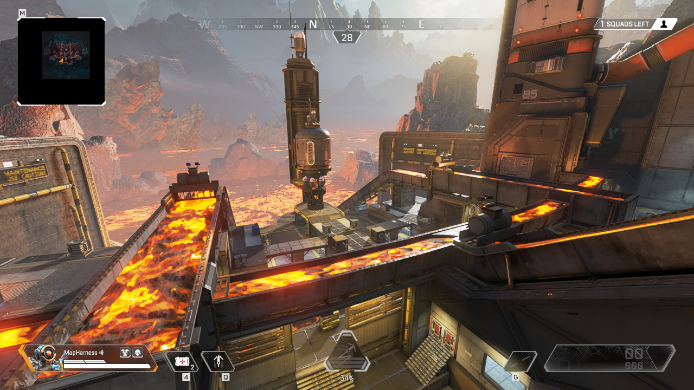
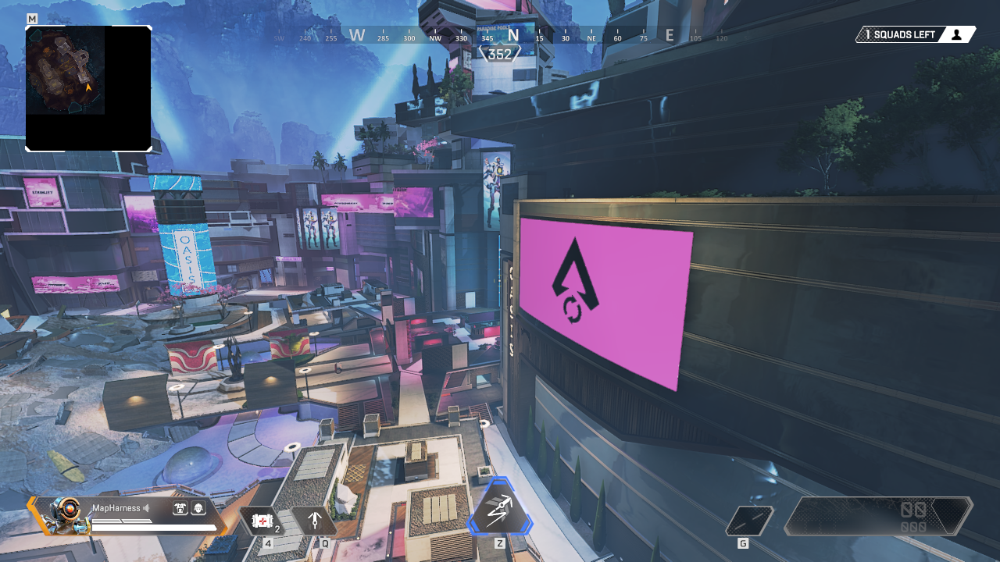

# Next Apex map conversion candidates

**Recommendation: Overflow next, followed by Party Crasher.** Both maps have
local source BSPs, client/server archives, map RPaks and working R5R comparison
captures. This is a feasibility assessment, not a playable port or a promise
that every source placement will fit. Phase Runner 1.6.0 and Drop-Off 0.10.0
were not changed.

## Measured shortlist

| Priority | Map / source name | Source brush triangles | Source static placements | Unique prop models | Base world capacity |
|---|---|---:|---:|---:|---:|
| 1 | Overflow / `mp_rr_aqueduct` | 542,645 | 5,863 | 261 | 51.79% |
| 2 | Party Crasher / `mp_rr_party_crasher` | 659,236 | 13,825 | 531 | 62.94% |
| 3 | Firing Range / `mp_rr_canyonlands_staging` | 39,385 | 5,371 | 160 | 3.76% |

Capacity uses the measured Titanfall 2 all-visible world index limit of
3,145,728, including per-mesh odd-triangle padding. These are **base brush
costs**, before baked prop geometry, menu geometry and conversion additions.
All source brush models and placements are included, including remote scenery;
these counts are not arena-only measurements. Triangle percentages are not
GPU performance measurements. Props can dominate a seemingly cheap map.

Use a conservative 95% world budget for initial builds, reserve batch and
collision capacity independently, and retain dynamic entity headroom. The
previous 97–98% request applied to the two existing releases; it does not
establish that this occupancy is appropriate for new maps or future AI.

## Overflow

The best reuse opportunity: 165 of 261 model names already have compiled local
exports from earlier recovery work. Those names cover 4,634 source placements
(79.0%). This does not mean those placements are converted: skins, full model
paths, textures, physics and placement regions still need verification. The
remaining 96 model names need extraction or another recovery method.

The native source captures show elevated industrial lanes, stairs, walls,
railings, cover and large molten channels. The layout looks promising for
pilot movement and team objectives. Titan clearance has not been tested.
Respawn's original description identifies its lane-focused design in the
[Thrillseekers announcement](https://forums.ea.com/blog/apex-legends-game-info-hub-en/enter-a-new-arena-in-the-thrillseekers-event/9463814).

Conversion work should prioritize:

- Recovering structural props and railings before minor signage and fixtures.
- Recreating the lava material with native emissive shading, plus correctly
  bounded player/Titan damage zones. Animated lava, smoke and heat effects need
  explicit treatment; a static albedo would lose much of the map's appearance.
- Separating the gameplay structure from expensive remote rock scenery.
- Rebuilding the existing working portal-free visibility, native collision,
  local lighting/probes, minimap, menu stage and gameplay spawn conventions.

There are approximately 453,127 triangles of room under the 95% target before
props. Even the already-exported source models total about 703,747 triangles
at LOD 3 or the last available LOD across **all** their placements. Therefore
this is not an import-everything candidate. Region filtering, sensible LODs and
preserving structural detail will be necessary. Foliage needs the separate
authored-LOD and grounding checks established in Phase Runner.

Other native source views: [industrial lanes](overflow/industrial-lanes.png)
and [central cover](overflow/central-cover.png).

## Party Crasher

This would add a distinct city/plaza setting, with the crashed Mirage Voyage,
two-storey buildings, roof routes and more vertical cover. Those defining areas
match Respawn's [Legacy introduction](https://www.ea.com/ea-play/news/legacy-update-patch-notes).

It is a larger asset recovery job: 131 of 531 model names have existing local
compiled exports, covering 2,176 placements (15.7%). It has 214 source surface
names versus Overflow's 116. Dense planted vegetation, advertisements, glass,
water-like decorative surfaces and moving lights increase material and
lighting work. Screens and advertisements can use the native emissive approach
already established for the two ports; animated content is a separate task.

Its base world leaves approximately 336,143 triangles under the 95% target.
Known exported prop placements already total about 343,665 LOD triangles before
the other 400 model names are counted. Preserve the Voyage, buildings, roofs,
stairs and cover first; consolidate or omit dense background foliage. Pilot
combat looks promising, but the interiors and stairs need separate Titan hull
checks. No Titan-mode compatibility is claimed by this assessment.

Other native source views: [Voyage/plaza side](party-crasher/mirage-voyage.png)
and [ground-level plaza](party-crasher/plaza.png).

## Firing Range

Worth considering as a movement, weapon and future AI test environment after
the two competitive arenas. Its low brush cost is misleading on its own:
5,371 static placements provide much of the terrain and environment. Only
26 model names covering 449 placements have existing compiled exports.

The installed BSP has an outer version 47 header and a `sprp` version 51
payload. The audit explicitly uses the same static-prop parser registered for
version 51 in the pinned `apex_legends51` branch; it does not silently interpret
the raw bytes as zero props. Target dummies, targets, weapon stations and
training interactions would require Northstar scripts; Apex AI navigation
files are not native Titanfall navigation. Source coordinates also require
recentering, with the gameplay spawns around `(26500, -7000, -27500)`.

The map loaded in R5R and an [initial spawn-surroundings capture](firing-range/overview.png)
was retained. That camera points at nearby rock/vista geometry rather than the
target range. It verifies the load and capture path; it is not a sufficient
visual survey of the training layout. A dedicated range route is still needed
before selecting it for a port.

## Larger maps and missing source maps

The local installation contains 21 `mp_rr_*` client map archives, including
several variants of the same battle royale environments. Client/server and
RPak presence are recorded independently in the audit. Archive presence alone
does not prove every map can load or every asset is recoverable.

| Installed source version | Brush triangles, without props | World capacity |
|---|---:|---:|
| Kings Canyon `mp_rr_canyonlands_mu2` | 2,013,717 | 192.42% |
| World's Edge `mp_rr_desertlands_mu2` | 2,726,052 | 260.41% |
| Olympus `mp_rr_olympus` | 2,544,201 | 242.88% |

Whole-map imports do not fit the current proven all-visible conversion path.
Selected POIs could be future candidates after defining explicit gameplay
bounds and measuring the retained world, props and collision. A full BR port
would need a separately validated streaming/visibility architecture; earlier
portal experiments must not be treated as solved.

`mp_rr_arena_empty` is not another completed arena: 1,386 of its 1,387 static
placements refer to `mdl/dev/empty_model.rmdl`, with one vista model. It could
be an SDK test environment but is not a useful next scenery conversion.

Encore and Habitat 4 were not found as map archives in the inspected local
installation. They are possible later investigations once a usable source
build and assets are available. No feasibility ranking or recovery percentage
is assigned to unavailable maps.

## Evidence and practical limits

- [Source audit and per-model recovery list](source-audit-2026-10-13.json).
- [Large-map mesh audit](large-map-brush-audit.json): CRC-verified extraction,
  supported v47 schema, mesh hashes and native index estimates.
- Native R5R camera receipts and PNG hashes are retained alongside the images.
  Three views each cover Overflow and Party Crasher, plus the limited Firing
  Range load capture described above.
  These are original game captures, not offline renders or desktop screenshots.
- The first fresh Overflow launch disconnected with a native server overflow.
  Loading it from the successful Party Crasher session subsequently worked and
  produced three captures. The initial failure's cause is not established.
- R5R is the installed SDK build, not an untouched retail Apex client. Its map
  scripts remove some `func_brush` entities for both arenas and Party Crasher
  adds moving lights. Screenshots are visual references; use the extracted
  source collision and entity ownership when rebuilding blockers and hazards.
- No conversion, collision contact tests, mode validation, AI navigation,
  multiplayer stress test or performance benchmark has been performed for
  these candidates. Raw source static flag values are recorded without assuming
  Titanfall flag meanings: most placements carry bit 4, so blindly treating
  that as `NO_DRAW` would discard visible source scenery.

Reproduce the offline audit with `audit_conversion_candidates.py` after
extracting each candidate's `maps/*` with `extract_map.py`. The large-map audit
only extracts headers and mesh records. `survey_conversion_candidates.py`
captures the selected source route through a running isolated R5R harness.
