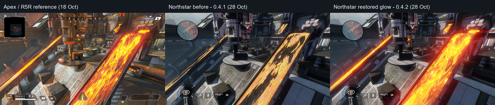

# Overflow lava: source comparison and HDR emission repair

Overflow **0.4.2** restores the large lava channels' HDR glow. Matched native
screenshots, PS/FFA spawn checks, both PS teams, postmatch lobby and stock/map
reload checks passed on Northstar 1.31.14 with one local client. The anniversary
RC1 and accepted 0.4.1 archives remain unchanged.

The Apex image is the preserved October 18 R5R reference; both native images are
fresh October 28 captures at the same camera and FOV. The glow is much closer to
the source without altering global exposure. Background lighting, tonemapping
and animated flow still differ between engines.

## Diagnosis

The matched `lava-channel` R5R and Northstar photographs from the October 18
release survey confirm the report: Apex has a bright yellow/orange lava surface
with substantial bloom, while the port is predominantly diffuse orange with dark
patches. Different global lighting/tonemapping also contributes to the overall
scene difference, so a whole-map exposure change is not an appropriate repair.

A native BSP ray from the saved camera at `(-500, -2500, 800)`, looking toward
the right channel at pitch 20, yaw -70, hits
`lava_river_aqueduct_01_bm` (mesh 782, about 802 units away). That material covers
6,832 drawn triangles. Its adapted Coliseum world blend shader has no emission
bindings and a zero emissive tint. Apex's reflected constants specify **10,10,10
for both emissive layers**, with a layer ramp of 20. Vertex alpha varies over
almost its full range; replacing that blend with one uniformly glowing texture
would lose the authored masks.

The separate `lava_river_flow_bm_transparent` surface covers 831 triangles and
already uses a native HDR material with its source 8.5 multiplier. Increasing
only that material would miss the large dull channels. The coincident
`lava_river_v3_bm` render layer was retired in 0.4.1 to fix z-fighting and remains
retired. Its collision is not changed by this work.

Thunderdome's current material mapping has no named lava material; Thermal
Station has the source-derived crack-mask lava treatment documented in
`bake_layer_emission.py`. The authoritative brightness/color reference for this
repair is Overflow's own Apex shader/constants and matched photographs.

## Candidate implementation

`native_lava_emission.py` extends the retained native world blend pixel shaders
with seven executable instructions: save the native blend weight, sample the two
source emission maps, blend them with that weight, multiply by the source HDR
tint and add after native diffuse compression, before retained fog. This avoids
the diffuse compression/clamping that would otherwise remove the HDR range.
The original normal/specular lighting, opacity variants, fog, motion/depth
outputs, input flags and vertex shader are preserved. Native debug variants
4/5/12/13 remain byte-identical. Production variants 0/1/8/9 gain the emission.

The extra texture bindings are t4 and t27. Both SHEX declarations and RDEF
resource metadata are extended, and the shader-set texture count becomes 28.
Unique shader GUIDs avoid colliding with the original shader assets. DXBC
container checksums are verified on inputs and regenerated on output using
the public [Microsoft container hash design](https://github.com/microsoft/DirectXShaderCompiler/blob/main/lib/DxilHash/DxilHash.cpp).
This format checksum is not used for security or asset provenance; SHA-256
continues to identify complete assets.

`fix_overflow_lava_emission.py` builds from the accepted 0.4.1 material state and
consolidates the added assets into the existing world pack. It restores the original source diffuse texture
instead of retaining the old tone-mapped emission baked into albedo. Emission
textures derive from each source emission map and its multiply map, combined in
linear space and stored as sRGB resident textures with mips. Source tint remains
10; no arbitrary saturation/exposure multiplier is applied.

One BSP material name is remapped to a unique HDR material, and its STBSP is
rebuilt. Binary comparison allows only string-table lumps 0x2b/0x2c and relocated
absolute game-lump offsets in 0x23 to differ. Geometry, visibility, vertex alpha,
indices, collision, baked lighting and safety entities remain unchanged. Builds
always start from the accepted baseline and replace modified files atomically.

## Checks so far and limits

- All eight nonempty pixel shader variants are accepted by a native D3D11 WARP
  device; four are extended and four diagnostic variants are retained.
- Five regression tests cover unchanged vertex/debug shaders, preservation of
  native executable instructions, binding/checksum consistency, emission
  placement and refusal to apply the patch twice.
- Candidate BSP and STBSP checks pass; the new map has the same rendering and
  collision geometry as 0.4.1.
- All 354 original materials and 829 original resident textures are unchanged;
  eight assets are added. Original production/debug shader buffers match the
  accepted pack before the targeted extension.
- Fresh `lava-channel`, `north-platform` and overview photographs were reviewed.
  PS/FFA spawn clearance/support, both PS teams, postmatch lobby, stock Coliseum
  and converted-map reload, weapon fire and error-log checks passed.

An initial separate-pack candidate stalled during loading while the unchanged
baseline loaded. Noninvasive stacks showed an RPak loader wait. The consolidated
world-pack candidate then loaded and passed the lifecycle checks. This is
consistent with a cross-pack dependency/order problem; the exact loader wait was
not isolated. The earlier EA attribution was not established. The accepted
build avoids that additional pack and retains the original Postload policy.

Source scrolling and UV distortion are not reconstructed. Multiply detail is
frozen into the two source emission textures, so the candidate is not a claim of
complete animated Apex lava parity. Multiplayer load, dedicated servers and AI
remain unverified; these checks use one local client. The earlier 1.31.13
intermittent loading-crash root cause remains unconfirmed.
