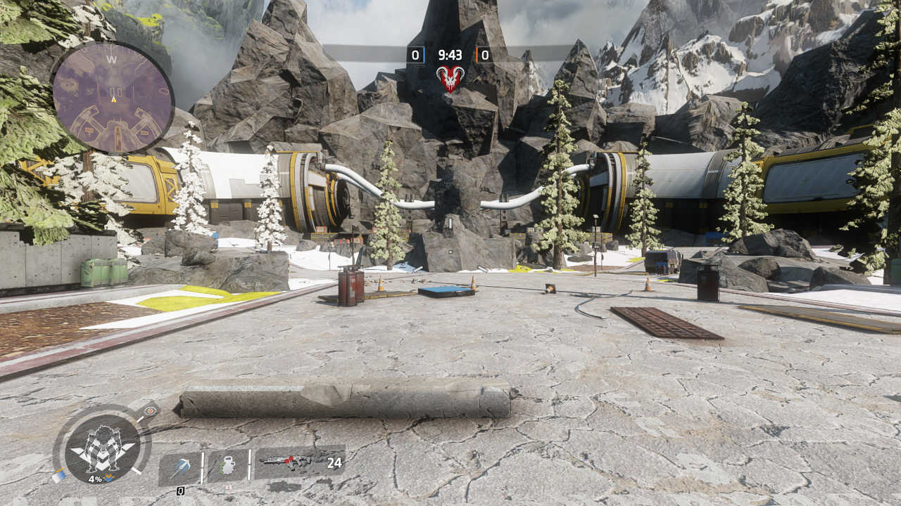
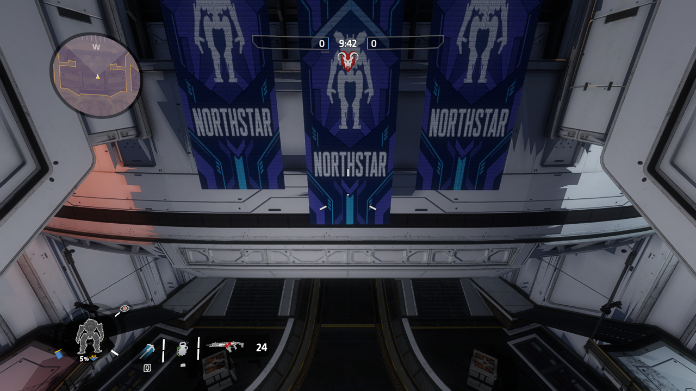

# Native minimaps for the arena ports

Phase Runner 1.5.0 and Drop-Off 0.9.0 add the original Apex overview artwork to
Titanfall's existing radar. These are navigation images, not rendered overhead
screenshots or a replacement HUD. Player markers, threat wedges and gameplay
icons continue to use Northstar's stock minimap implementation.

## Overview conversion

| Setting | Phase Runner | Drop-Off |
| --- | --- | --- |
| Source map | `mp_rr_arena_phase_runner` | `mp_rr_arena_composite` |
| Target map | `mp_phase_runner` | `mp_arena_composite` |
| Exported image dimensions | 4100 × 4100 | 4096 × 4096 |
| Source corner X, Y | 17901, 26514 | -7196, 10181 |
| Source units per pixel | 4 | 3.5 |
| Translation subtracted from source | 26000, 19000, 0 | 0, 0, 0 |
| Target corner X, Y | -8099, 7514 | -7196, 10181 |
| Target image dimensions | 1024 × 1024 | 1024 × 1024 |
| Target units per pixel | 16.015625 | 14 |

Original overview files are in `inputs/extracted-client/resource/overviews/`
and `inputs/composite/client/resource/overviews/`. The locally extracted source
images are identified in `build_arena_minimaps.py`. Source game files and their
compiled images are excluded from Git.

The Phase Runner UI atlas header confirms a full 4100-pixel image, identity UVs
and identity offsets. Do not arbitrarily crop it to 4096 pixels. Resize the
complete artwork to 1024 pixels using Lanczos filtering. Preserve orientation,
alpha and sRGB colour. The full image covers 16400 world units for Phase Runner
and 14336 for Drop-Off.

For a translated, unscaled map:

```text
target_corner = source_corner - map_translation_xy
target_scale = source_scale * source_image_width / 1024
image_x = (target_world_x - target_corner_x) / target_scale
image_y = (target_corner_y - target_world_y) / target_scale
```

The image Y direction opposes world Y. No X/Y swap, mirroring or rotation is
needed for these ports. A later conversion that rotates or scales geometry
must also transform its overview.

Keeping the source units per pixel produced a blank radar even though native
configuration queries returned the correct overview path and coordinates.
A native radar-layer probe with the corrected scale displayed the artwork.
This is empirical evidence that the tested Titanfall radar uses a 1024-pixel
reference; it is not a claim that the compiled RUI program has been decoded.

## Runtime files

Each mod adds `mod/resource/overviews/<target_map>.txt` and one self-contained
native v7 RPak. The overview `assets/minimap` points to
`overviews/<target_map>`. Each RPak contains only:

- A resident BC7 sRGB texture, one mip, approximately 1 MiB.
- A v10 `uimg` atlas with one full-image entry and its folded path hash.

The atlas GUID follows the stock naming convention
`ui_image_atlas/overviews/<target_map>.rpak`; its image name is the overview
asset path without an extension. The RPak is postloaded with `common.rpak`.
There are no new RUI programs, DLLs, world materials, scripts or streaming
assets. The native `cl_minimap.gnut` reads the overview and binds its image,
corner and scale when the local player is created.

The atlas mechanism is described in the
[Northstar UI image documentation](https://r2northstar.readthedocs.io/en/latest/repak/assets/uiatlas.html).
The current RePak builder uses `images`, `_type` and `_path`, rather than the
older example's `textures`, `$type` and `path`; consult the checked local tool
source and `build_arena_minimaps.py` for the actual manifest.

## Reproduction and scope

The final candidate passed five native captures per map, configuration queries
and a return to Drop-Off in the same game process (11 captures total, no script
errors). Checks cover both ends of each map, heading changes, a tunnel and an
upper platform. A radar-colour check rejects the blank black image from the
initial failed scale test. Native PNG hashes are verified against their capture
records. This run used Skirmish; no new multiplayer balance or AI validation is
claimed.





Run `build_arena_minimaps.py` with local artwork and RePak/DirectXTex available.
It records the pre-change runtime hashes, verifies native atlas headers,
dimensions, UVs, image hashes and texture dependencies, then stages the overview
files and Postload entries. It asserts that source and target world coverage
are equal. `capture_arena_minimaps.py` checks both spawns/buildings, the center
at two headings and a platform/tunnel, records native screenshots and queries
the actual loaded configuration.

The final release verification rejects changes to existing runtime files other
than `mod.json` and the RPak loading configuration. All BSPs, geometry budgets,
collision, portals/visibility, lightmaps, probes and world material packs are
preserved. Existing clean releases remain available as rollback copies.

The artwork depicts the original Apex layout. Titanfall additions such as
Phase Runner's tunnel catwalks are not separately drawn. The radar provides a
single overhead layer; it does not distinguish multiple floors or add a new
full-screen tactical-map interface. Native objective markers remain governed
by the existing game-mode scripts.
